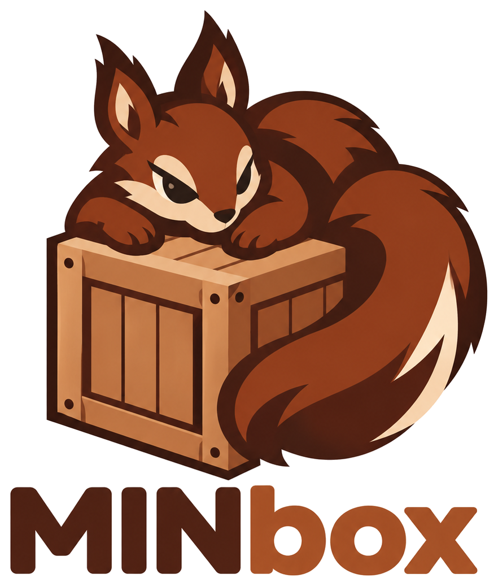
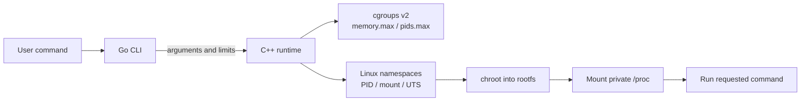

<p align="center">
  
</p>

<h1 align="center">MINbox</h1>

<p align="center">
  A small Linux container runtime built to explore how containers work under the hood.
</p>

<p align="center">
  
  
  
  
</p>

---

MINbox is an educational, single-container runtime. A Go command-line interface parses options and starts a small C++ runtime. The runtime uses Linux namespaces, `chroot`, and cgroups v2 to launch a command inside a supplied root filesystem.

> **Status:** Working prototype. It is intended for learning and experimentation, not as a secure replacement for Docker or other production runtimes.

## What it can do

| Capability | How MINbox implements it |
| --- | --- |
| Root filesystem | Changes the container process root with `chroot` |
| Process isolation | Creates a PID namespace; the container command starts as PID 1 |
| Process view | Mounts a private `/proc` for the PID namespace |
| Hostname | Sets an isolated UTS hostname to `minbox` |
| Memory limit | Applies a cgroups v2 `memory.max` limit |
| Process limit | Applies a cgroups v2 `pids.max` limit |
| Shutdown cleanup | Handles common termination signals, waits briefly for PID 1, then force-stops it if needed and removes its cgroup |

## How it is put together



### Source layout

```text
cmd/minbox/                  Go CLI entry point
internal/cli/                Argument parsing and memory-size conversion
internal/runtimeclient/      Starts minbox-runtime and forwards signals
runtime/CMakeLists.txt       CMake build for the C++ runtime
runtime/include/minbox/      Runtime headers
runtime/src/main.cpp         Namespaces, cgroups, rootfs, and process lifecycle
```

## Requirements

- Linux with cgroups v2 mounted at `/sys/fs/cgroup`
- Go 1.24.4 or newer
- CMake 3.16 or newer and a C++17 compiler
- Root privileges for namespaces, `chroot`, and cgroup configuration
- A root filesystem containing the command and its runtime libraries

The memory and process controllers must be available in the cgroups v2 hierarchy. MINbox currently creates its cgroups directly under `/sys/fs/cgroup`, so it needs permission to configure that hierarchy.

## Build

Run these commands from the repository root:

```sh
cmake -S runtime -B runtime/build
cmake --build runtime/build
sudo install -m 0755 runtime/build/minbox-runtime /usr/local/bin/minbox-runtime
go build -o minbox ./cmd/minbox
```

The Go CLI looks up `minbox-runtime` through `PATH`; the install command makes it available at `/usr/local/bin/minbox-runtime`.

## Prepare an Alpine root filesystem

The following example uses Alpine 3.24.0, the minirootfs version used during development. Run it from the repository root. Extract into an empty `rootfs` directory.

```sh
ALPINE_VERSION=3.24.0
ALPINE_ARCH=x86_64
ALPINE_ARCHIVE="alpine-minirootfs-${ALPINE_VERSION}-${ALPINE_ARCH}.tar.gz"
ALPINE_BASE_URL="https://dl-cdn.alpinelinux.org/alpine/v3.24/releases/${ALPINE_ARCH}"

curl -fL -o "/tmp/${ALPINE_ARCHIVE}" "${ALPINE_BASE_URL}/${ALPINE_ARCHIVE}"
curl -fL -o "/tmp/${ALPINE_ARCHIVE}.sha256" "${ALPINE_BASE_URL}/${ALPINE_ARCHIVE}.sha256"
(cd /tmp && sha256sum -c "${ALPINE_ARCHIVE}.sha256")

mkdir -p rootfs
tar -xzf "/tmp/${ALPINE_ARCHIVE}" -C rootfs
sudo install -d -m 0755 rootfs/dev rootfs/proc
if [ ! -e rootfs/dev/null ]; then
  sudo mknod -m 666 rootfs/dev/null c 1 3
fi
```

Alpine publishes its [container minirootfs downloads](https://www.alpinelinux.org/downloads/). The example pins a version so the same root filesystem can be reproduced; update the version and URL together when choosing another release.

## Run a container

Start an interactive shell:

```sh
sudo ./minbox run --rootfs ./rootfs -- /bin/sh
```

Run a command and inspect the isolated process view:

```sh
sudo ./minbox run --rootfs ./rootfs -- /bin/sh -c \
  'echo "Hello from MINbox"; echo "PID inside: $$"; hostname; ps'
```

The shell starts as PID 1, and the hostname inside the container is `minbox`.

## Set resource limits

```sh
sudo ./minbox run --rootfs ./rootfs \
  --memory 64M \
  --pids 64 \
  -- /bin/sh -c 'cat /proc/self/cgroup; ps'
```

`--memory` accepts a positive whole number of bytes or a size suffix. Unit suffixes are case-insensitive.

| Example | Meaning |
| --- | ---: |
| `67108864` | 67,108,864 bytes |
| `64M`, `64MiB` | 64 MiB (67,108,864 bytes) |
| `64MB` | 64,000,000 bytes |
| `1G`, `1GiB` | 1 GiB (1,073,741,824 bytes) |

Short `K`, `M`, `G`, and `T` suffixes, plus `KiB`, `MiB`, `GiB`, and `TiB`, use powers of 1024. `KB`, `MB`, `GB`, and `TB` use powers of 1000. `--pids` takes a positive whole-number process count.

When a limit is exceeded, Linux enforces it: creating another process can fail at `pids.max`, and the cgroup OOM handler can kill a process at `memory.max`. The cgroup is removed when the container exits.

## Signal handling

MINbox forwards `SIGINT`, `SIGTERM`, `SIGHUP`, and `SIGQUIT` to the runtime. The runtime forwards the signal to the container's PID 1, waits up to two seconds for it to exit, and uses `SIGKILL` as a fallback. It then reaps the container process and removes the cgroup. The CLI returns the conventional `128 + signal number` status for signal-initiated shutdowns.

## Current scope

MINbox currently runs one container command at a time. It does **not** yet implement network namespaces or container-to-container networking, CPU limits, user namespaces, seccomp, capability dropping, or image building and orchestration.

## Security note

This is a learning project, not a hardened sandbox. It does not yet drop Linux capabilities, use user namespaces, apply seccomp filters, or make the root filesystem read-only. Do not use it to run untrusted workloads or as a multi-tenant isolation boundary.
